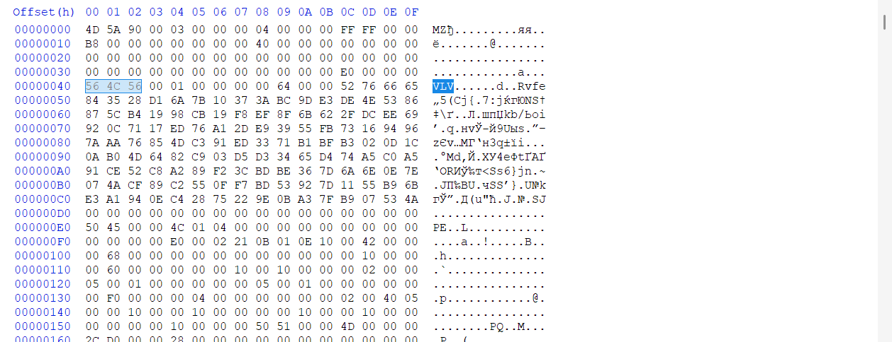
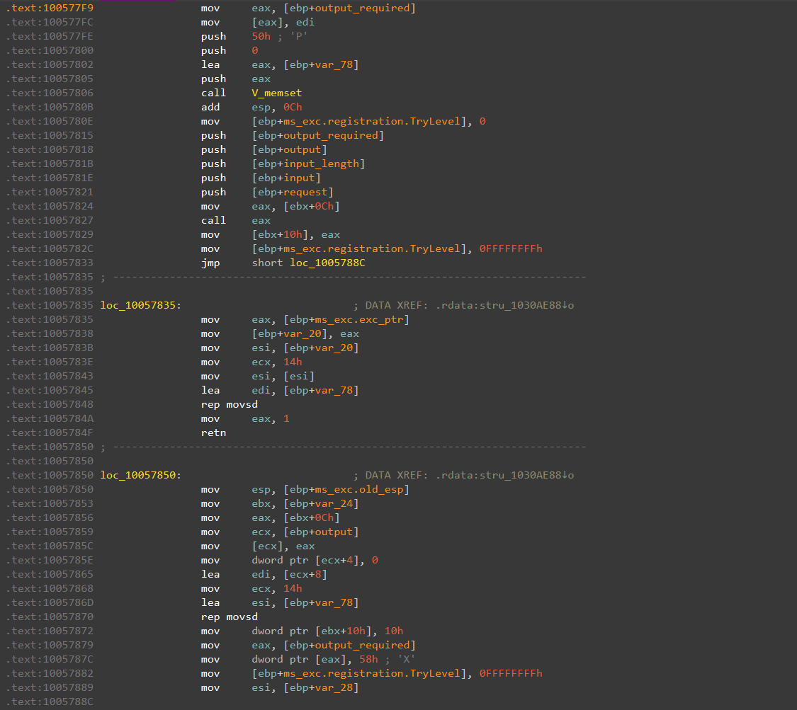
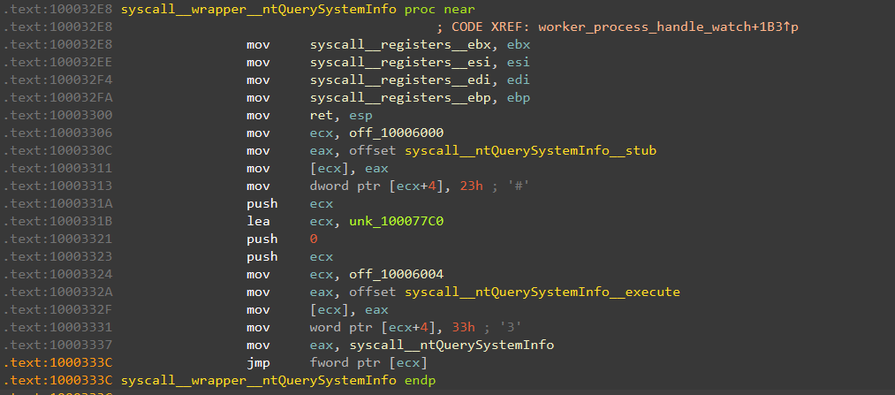
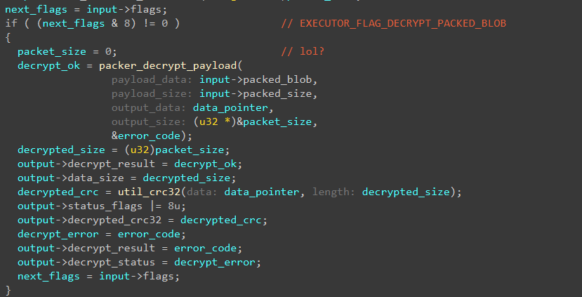
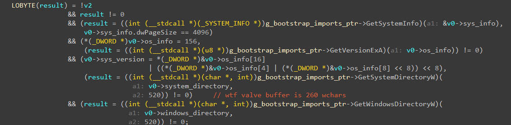
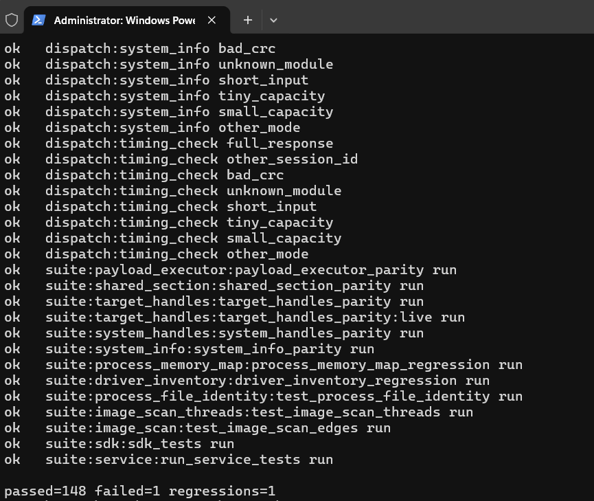

# Autopsy of a dead anti-cheat: 15 classic VAC modules rebuilt bit-for-bit in C++20

Hey everyone, back with another writeup that two and a half people will actually read. When the Steam client finally moved to x64, Valve practically buried their classic 32-bit VAC. Out of the old zoo, only a single lonely HWID module occasionally spins inside the external 32-bit `steamservice`, while the main pack of combat scanners went straight to the graveyard. Suffering from a wrecked sleep schedule, I decided to practice some digital necrophilia, dig up this corpse, and rewrite the whole thing from scratch in C++20. Specifically, I wanted every rebuilt module to produce the exact same 4232-byte report on the same inputs as Valve's original DLLs. Bit for bit, including all of their bugs and uninitialized stack garbage.

On the operating table we have 15 scanner modules and the host `steamservice.dll` itself (CRC `7ebac2a4`). Let's see how this thing lived and why it finally died.


---

## Part 1: Who pulls the strings (`steamservice.dll`)

By themselves, VAC modules are dumb stateless DLLs. A packet arrives from the server, the scanner runs, spits out 4 kilobytes of report data, and forgets everything. So it makes sense to start digging inside the host `steamservice.dll`, which receives, verifies, and maps these modules in memory.

Following an old Valve tradition, the developers left assert strings with source file paths right inside `steamservice.dll`, and older macOS builds even kept part of the symbols intact. No guesswork needed. The module manager lived in `SteamServiceClient/servicemodulemanagerbase.cpp` and `servicemodulemanagerasync.cpp`, while `common/vacprocessmonitor.cpp` watched over running processes.

A request inside the service goes through five steps:

1. The Steam client sends an IPC request to `CServiceEngine::RunInterface` (interface ID `2`), which drops the call into a single-threaded work queue via `CClientModuleManagerAsync::CallFunctionAsync`.
2. The worker thread picks up the job in `CWorkItemFunctionCall::ThreadProcess` and, unless `MF_LEGACY_COMPATIBLE` (`8`) is set, forwards it to `CallFunctionAsyncInternal`.
3. `LoadDynamicModule` checks the image `CRC32` and verifies the cryptographic signature through `VerifyValveSignature`.
4. If the `MF_HIDDEN_MODULE` (`2`) flag is passed, the module is manually mapped into memory via `LoadModuleHiddenInternal`. Otherwise the DLL is dumped to a temporary file on disk and loaded through a normal `LoadLibrary`.
5. The service resolves the `_runfunc@20` export, calls it inside an SEH block (`__try / __except`), and returns either 4232 bytes of encrypted report or an 88-byte `ExceptionResponse_t` crash report with status `16` (`k_ECallResultException`).

### Signing over the DOS stub

First, `LoadDynamicModule` checks the incoming DLL's `CRC32` and calls `VerifyValveSignature`. Normal people put digital signatures into the standard PE `IMAGE_DIRECTORY_ENTRY_SECURITY` directory. Valve decided not to bother with Windows Authenticode parsing and slapped their own 144-byte header right on top of the standard DOS stub ("This program cannot be run in DOS mode"), immediately after `IMAGE_DOS_HEADER` at offset `0x40`:

```cpp
// service/src/signature/valvesignature.cpp
// @note / sapdragon: the signature block sits in the dos stub, right after the dos header
struct ValveSignatureHeader_t
{
	uint32_t m_unMagic;           // +0x40: 'VLV' (0x564C56)
	uint32_t m_unVersion;         // +0x44: 1
	uint32_t m_cubSigned;         // +0x48: signed image size
	uint32_t m_unReserved;        // +0x4C: 0x65667652 ('Rvfe', ignored by verification)
	uint8_t m_rgubSignature[128]; // +0x50..+0xCF: RSA-1024 signature
};
static_assert( sizeof( ValveSignatureHeader_t ) == 0x90 );
```

The check itself is dead simple. In memory, the service zeroes out those 128 signature bytes, the PE `CheckSum` field, and the security directory, hashes the image with `SHA-1`, and verifies the PKCS#1 signature against a hardcoded RSA-1024 public key (`e = 17`). The key table in the service has room for two slots, but the first slot is empty, so there is only one real key and all 15 of our modules are signed with it.



### Textbook Manual Map and crash reports

Next, the DLL has to be loaded. Without `MF_HIDDEN_MODULE` (`2`), the service just writes the file to a temp folder and calls `LoadLibrary`. When the flag is set, `LoadModuleHiddenInternal` takes over:

```cpp
// service/src/image_loader/win32imageloader.hpp
struct CWin32ModuleLoader
{
	BOOL m_bModuleLoaded;
	void *m_pBaseAddress;
	PIMAGE_NT_HEADERS32 m_pNTHeaders;
	uint32_t m_uiImportedModulesCount;
	HMODULE *m_ppImportedModules;
};
static_assert( sizeof( CWin32ModuleLoader ) == 0x14, "the original allocates exactly this much" );
```

Nothing fancy here, just a textbook manual mapper. It allocates a buffer of `SizeOfImage` bytes, copies sections, fixes relocations, resolves imports, applies page protections, and walks the export table by hand to find `_runfunc@20` so the module stays out of `PEB->Ldr`. Every module has `AddressOfEntryPoint = 0` in its PE header, so `DllMain` is never called. Once loaded, the module sits in the manager's cache and only gets unloaded after 30 minutes (`1800` seconds) of complete inactivity.

What happens when a module crashes is much funnier. The call to `_runfunc@20` is wrapped in `__try / __except`. If a scanner dereferences a bad pointer and triggers an Access Violation, the service doesn't die. Instead, it writes an 88-byte (`0x58`) `ExceptionResponse_t` structure straight into the output buffer:

```cpp
// service/src/module_manager/servicemodulemanagerbase.hpp
struct ExceptionResponse_t
{
	PfnServiceFunction_t m_pServiceFunction; // +0x00: _runfunc@20 address
	uint32_t m_unReserved;                   // +0x04: 0
	EXCEPTION_RECORD32 m_Record;             // +0x08: 80-byte EXCEPTION_RECORD
};
static_assert( sizeof( ExceptionResponse_t ) == 0x58 );
```

Because of this, the output buffer in the service must be at least 88 bytes. The call status changes to `16` (`k_ECallResultException`), and right inside `PollResponseAsync` we meet the first gift from Valve's programmers. If the caller's output buffer is too small for a normal report, the function properly returns `OutputTooSmall` (`5`). But if the 88-byte crash report doesn't fit, it returns `OutputTooLarge` (`15`). Wrong enum constant, happens to the best of us.



There is also a weird branch behind flag `8` (`MF_LEGACY_COMPATIBLE`). In that mode the service skips signature verification and doesn't load the module into its own process at all. It dumps `legacycompat/servicecall_<crc>.dll` and `.in` to disk, spawns an external `legacycompat/steamservice.exe /runfunc ...`, waits 20 seconds, and reads back `.out`.

---

## Part 2: Dissecting a module and building the SDK

Now let's look inside a typical module DLL. When you open the first binary in IDA, it looks like a ton of code. Open a second and a third, and you realize 70% of the functions are copy-pasted across all of them. None of the modules link the standard CRT, their static import table from `kernel32.dll` is almost empty, and the only export is `_runfunc@20`.

I pulled all of that shared scaffolding into `sdk/src`:

- `core/` holds the `_runfunc@20` entry point, the `.vacini` section, `RunDispatcher`, the guard-page sandbox around the report buffer, and `SealResponse`.
- `bootstrap/` handles `BootstrapMain`, decrypting the `g_EncryptedBlob` import array (`0xFC0` bytes), resolving 172 functions into `s_Imports`, and populating `ModuleSession_t`.
- `crypto/` implements the 16-round ICE block cipher, a custom `Bignum_t`, raw unpadded RSA-512, a Park-Miller PRNG, `CRC32`, `MD5`, and the polynomial hash `Hash488781ED`.
- `nt/`, `pe/`, `process/`, `file/`, `compress/`, and `verify/` provide helpers for reading `PEB32`/`PEB64`, streaming relocation-stripped MD5 hashes of PE images, opening files by NTFS File ID, embedded `LZ4`, and WinTrust signature checks.

Even on the basic path from `_runfunc@20` to the worker, Valve's signature quirks show up right away.

### 1. The `.vacini` CRT replacement and running initializers twice

With the CRT stripped and `DllMain` disabled, something still has to register the scanner functions at startup. Each module puts function pointers into a custom `.vacini` section. Those initializers link a worker's `Module_t` node into the global singly linked list `g_pModuleListHead`:

```cpp
// sdk/src/core/module.hpp
struct Module_t
{
	Module_t *m_pNext;       // +0x00
	u32 m_unId;              // +0x04: worker ID
	u32 m_unVersion;         // +0x08: version (always 1)
	PfnWorker_t m_pfnWorker; // +0x0C: scanner function pointer
	u8 m_rgubIceKey[36];     // +0x10: ICE key (only the first 8 bytes are used)
};
VAC_LAYOUT_SIZE( Module_t, 0x34 );
```

At the start of `_runfunc@20`, `CallInitializers()` walks `.vacini`. Then it checks `nMode`, returning `3` (`NoDispatch`) if the caller passed anything other than `4`. And right after the dispatcher finishes, we get this gem:

```cpp
// sdk/src/core/entry.cpp
// @note / sapdragon: non-zero from the start, so the initializers always run again after dispatch
constinit u32 s_bRunInitializersAgain = 0xFFFFFFFFu;
// ...
	if ( s_bRunInitializersAgain )
		CallInitializers();
```

Someone created a flag named `s_bRunInitializersAgain`, initialized it to `0xFFFFFFFF`, and forgot to write the code that clears it. As a result, every single call to `_runfunc@20` runs all initializers before the scan, and then pointlessly runs them a second time right before returning.

### 2. Packets, ICE, and the `PAGE_NOACCESS` sandwich

The input and output packet layouts are fixed across every module:

```cpp
// sdk/src/core/packets.hpp
struct VacInputPacket_t
{
	u32 m_unModuleId;                                // +0x00: worker ID
	u32 m_unVersion;                                 // +0x04: version (1)
	u32 m_unConfigCrc32;                             // +0x08: CRC32 of decrypted config
	u32 m_unSessionId;                               // +0x0C: session echo token
	u8 m_rgubEncryptedConfig[k_cubEncryptedConfig];  // +0x10..+0xAF: 160 bytes under 64-bit ICE
};
VAC_LAYOUT_SIZE( VacInputPacket_t, 0xB0 );

struct VacReportHeader_t
{
	u32 m_unSessionId;                               // +0x00: overwritten by dispatcher after worker
	u32 m_unWorkerResult;                            // +0x04: m_pfnWorker return code
	u32 m_unReserved;                                // +0x08: 0
};
VAC_LAYOUT_SIZE( VacReportHeader_t, 0x0C );

struct VacOutputPacket_t
{
	u8 m_rgubEncryptedReport[k_cubReport];           // +0x0000..+0x0FFF: 4096-byte report under session ICE
	u32 m_cubRsaPayload;                             // +0x1000: 0x40
	u32 m_unRsaStatus;                               // +0x1004: 0 on RSA success
	u8 m_rgubRsaSessionKey[0x80];                    // +0x1008..+0x1087: SessionKey_t under RSA-512
};
VAC_LAYOUT_SIZE( VacOutputPacket_t, 0x1088 );
```

`RunDispatcher` looks up the requested `Module_t` by ID (with the loop condition written so that if it ever hits an empty node with `m_pfnWorker == nullptr`, it stops there and happily tries to call a null pointer), decrypts the 160-byte config with ICE (Valve's favorite block cipher since the Source engine days), and verifies `CRC32`.

What happens next shows how much Valve trusted their own scanner code. Instead of allocating a normal heap buffer for the report, the dispatcher reserves a region with `PAGE_NOACCESS` via `VirtualAlloc`, and only marks the inner two pages `PAGE_READWRITE`, leaving a dead guard page on each side:

```cpp
// sdk/src/core/dispatcher.cpp
	const u32 cubSandbox = s_cubPage * ( ( s_cubPage + sizeof( VacOutputPacket_t ) - 1 ) / s_cubPage + 2 );
	u8 *pubSandbox = static_cast<u8 *>( VirtualAlloc( nullptr, cubSandbox, MEM_COMMIT | MEM_RESERVE,
	                                                  util::MapProtectionFlags( util::EProtectMode::NoAccess ) ) );
// ...
	u8 *pubReport = pubSandbox + s_cubPage;
	if ( VirtualProtect( pubReport, cubSandbox - 2 * s_cubPage,
	                     util::MapProtectionFlags( util::EProtectMode::ReadWrite ), &unOldProtect ) )
```

If a worker messes up an index while writing its report and runs past the two working pages (8 KB for `VacOutputPacket_t`), it doesn't corrupt the service heap. It slams straight into `PAGE_NOACCESS` and flies into the SEH handler with a crash report.


### 3. The identical 172-import blob in every module (`BootstrapMain`)

To keep analysts from seeing which WinAPI functions a scanner uses just by looking at the PE header, the static import table in each module is nearly empty. The real import list is hidden inside `.rdata` as a 4032-byte (`0xFC0`) array called `g_EncryptedBlob`. When a worker starts, it calls `BootstrapMain(&input)`, which decrypts this blob with ICE using the first 8 bytes of the decrypted input config as the key.

Sounds clever at first. Without a captured network packet containing the input parameters, you can't even read the import strings statically. Except once I decrypted these blobs across all modules, it turned out Valve never changed their contents! Every single module carries the exact same byte-for-byte list of 172 functions across 12 system DLLs (`kernel32`, `ntdll`, `advapi32`, `setupapi`, `wintrust`, and so on). In the SDK, this blob is built at compile time via `consteval BuildBlobImage()`:

```cpp
// sdk/src/bootstrap/blob.hpp
inline constexpr ImportName_t k_rgImportNames[] = {
#define VAC_IMPORT( szLibrary, ReturnType, Name, Args ) { szLibrary, #Name },
#include "bootstrap/imports.inl"
#undef VAC_IMPORT
};
static_assert( ARRAYSIZE( k_rgImportNames ) == 172 );
```

Even if the `cpuid` module only needs a single function (`SetThreadAffinityMask`), `BootstrapMain` still loads all 12 libraries and resolves all 172 pointers into `s_Imports` on every run.

### 4. Sealing the response (`SealResponse`) and textbook RSA without padding

Once the worker finishes, `SealResponse` packs the result for the server:

1. It seeds a simple Park-Miller PRNG (`ParkMiller_t`) using `__rdtsc()`.
2. It generates a random 8-byte ICE session key and fills `SessionKey_t`, which also records the actual number of bytes written (`*pcubOutput`).
3. Any unused tail of the 4096-byte report buffer is filled with PRNG garbage so the packet size stays constant.
4. The 28-byte `SessionKey_t` structure is encrypted with an RSA-512 public key (`k_rgubRsaPublicKey`), and the 4096-byte report is encrypted with the session ICE key. The RSA implementation here is straight out of a high-school textbook: no PKCS#1 or OAEP padding at all, just custom `Bignum_t` computing raw $m^e \bmod n$. The final output packet is always `0x1088` (4232) bytes.

---

## Part 3: Map of all 15 modules

Before diving into the funniest workers, here is the full excavated collection. Some modules had paired rebuilds with rotated keys, and `image_scan` and `image_scan_threads` are literally compiled from the exact same source (their `.text` sections match byte for byte apart from build timestamps), with one calling the first worker and the other calling the second.

| Module | Build CRCs | Worker IDs | What it does |
|---|---|---|---|
| `boot_config` | `2909d63a` | `0x06A79A9E` | Reads the `HKLM\BCD00000000\Objects` registry hive: bootloader, kernel, and HAL paths, `testsigning` and `nointegritychecks` flags, NX policy, plus NTFS File ID and volume serial. |
| `cpuid` | `f418b1dc` | `0x023429C3` | Pins the thread to CPU 0 and dumps `CPUID` leaves from `0x0`, `0x40000000` (hypervisor leaf checked before extended leaves), and `0x80000000`, up to 169 records. |
| `devices` | `40e4df95` | `0x05EC50DC` | Enumerates active PCI and USB devices via SetupAPI, up to 508 `VendorID / DeviceID / Class` triples. |
| `driver_inventory` | `2023d8c3` | `0x06ACD913`<br/>`0x06C2B5BB` | Two workers: the first cross-checks active driver services (`EnumServicesStatusW`) against the `\Driver` kernel object directory; the second computes relocation-normalized MD5 hashes of driver files on disk (up to 203 files). |
| `image_scan` | `33211402` | `0x0CDA6778`<br/>`0x09D3248C` | Two workers: PE scanner on disk and in memory (headers, relocation-stripped section MD5s, icons, PDB path, WinTrust certificates, streaming pattern scan) + dump of up to 253 process threads and their start addresses. |
| `image_scan_threads` | `74aa703a` | `0x05A52008`<br/>`0x0122C7DA` | Exact same `.text` as `image_scan`, just built with different keys and worker IDs. |
| `payload_executor` | `60e41c53` | `0x0236ED5F` | Allocates memory, RSA-unpacks a blob, sets `PAGE_EXECUTE_READWRITE`, and calls a function at an offset. |
| `process_file_identity` | `a8848995`<br/>`42878040` | `0x0B2D8276`<br/>`0x0CA11165`<br/>`0x013B4330`<br/>*(and `0x0E5CD15B`, `0x05CEDF74`, `0x0FF6FF81`)* | Three workers: process dossier (SID, PEB32/64, cmdline, hashes), NTFS File ID chain for all ancestor folders, and a directory inventory of up to 200 files. |
| `process_memory_map` | `8d88e017`<br/>`78a6ef0f` | `0x06E048F4`<br/>`0x0DB55D3C` | Walks `PEB->Ldr` and process memory regions, folds pages, computes normalized MD5 for up to 32 PE images, and compresses the report tail with LZ4. |
| `service_lookup` | `87f12249` | `0x0FA94991` | Looks up a specific driver by service name hash, expands `sysnative`, and grabs service config and NTFS File ID. |
| `shared_section` | `2794a04`<br/>`9b85c913` | `0x0E3481C0`<br/>`0x06781BC4` | Hunts for shared memory sections matching a GUID pattern via `OpenFileMappingW` and recursive NT `\` object directory traversal, reading 4072 bytes from offset 24. |
| `system_handles` | `1da8fb5c`<br/>`9f73e639` | `0x002F6DC7`<br/>`0x0929BC41` | Process snapshot, 64-bit handle type bitmasks per PID, and hidden process brute-force stepping down by 4 via `OpenProcess`. |
| `system_info` | `a07ed54b` | `0x0F8083A0`<br/>`0x0C2232C2` | Two nodes pointing to one worker: OS summary, `KUSER_SHARED_DATA` timers, volumes, and parsing on-disk `ntdll.dll` to extract 4 raw syscall numbers (SSNs). |
| `target_handles` | `762110ce` | `0x08A9324E` | Jumps from 32-bit WoW64 into x64 via Heaven's Gate (`0x33`) and uses direct syscalls to find external processes holding an open handle to the game. |
| `timing_check` | `de9615cb` | `0x0D8C40E1` | Ancient module without `BootstrapMain`: samples `KUSER_SHARED_DATA` ticks around a call to a self-modifying stub in `.data`. |

We can skip the routine stuff like USB device polling or BCD registry reads and focus on the five most interesting mechanics.

---

## Part 4: Five interesting mechanics inside the scanners

### 1. The `system_info` and `target_handles` duo: jumping through Heaven's Gate (`0x33`)

When I opened `target_handles` (`762110ce`), its purpose was obvious: find every process on the system holding an open handle to the game process. But the anti-cheat runs inside a 32-bit process under WoW64. If you simply call `NtQuerySystemInformation` from 32-bit `ntdll.dll`, first, any basic usermode hook will catch you, and second, the 32-bit `SYSTEM_HANDLE_TABLE_ENTRY_INFO` structure truncates 64-bit kernel object addresses.

That is where the puzzle clicked together with another module, `system_info` (`a07ed54b`). Watch the sleight of hand: first, `system_info` reads a clean copy of `ntdll.dll` from disk, parses its export table, and scrapes the raw syscall numbers (SSNs) out of the prologues of four functions (`NtReadVirtualMemory`, `NtQueryVirtualMemory`, `NtOpenProcess`, `NtQuerySystemInformation`). The server collects that report and later sends `target_handles` an input packet with the exact SSNs for the player's Windows build already sitting at offsets `+0x68` and `+0x6C`!

Next, `target_handles` executes a far jump (`jmp fword`) to selector `0x33` (Heaven's Gate, shoutout to Slyaqot!), switching the CPU from 32-bit mode into 64-bit mode, and fires a direct 64-bit `syscall`. Because MSVC's 32-bit inline assembler doesn't understand 64-bit instructions or `REX` prefixes, I had to lay out the gate as raw bytes using `__asm _emit`, just like the original binary:

```cpp
// modules/target_handles/internal/syscalls.cpp
__asm _emit 0x48 __asm _emit 0x8B __asm _emit 0x4C __asm _emit 0x24 __asm _emit 0x08 /* mov rcx, [rsp+8] */   \
__asm _emit 0x48 __asm _emit 0x8B __asm _emit 0x54 __asm _emit 0x24 __asm _emit 0x10 /* mov rdx, [rsp+10h] */ \
__asm _emit 0x4C __asm _emit 0x8B __asm _emit 0x44 __asm _emit 0x24 __asm _emit 0x18 /* mov r8, [rsp+18h] */  \
__asm _emit 0x4C __asm _emit 0x8B __asm _emit 0x4C __asm _emit 0x24 __asm _emit 0x20 /* mov r9, [rsp+20h] */  \
__asm _emit 0x4C __asm _emit 0x8B __asm _emit 0xD1                                   /* mov r10, rcx */       \
__asm _emit 0x0F __asm _emit 0x05                                                    /* syscall */            \
__asm _emit 0x4C __asm _emit 0x8B __asm _emit 0x17                                   /* mov r10, [rdi] */     \
__asm _emit 0x48 __asm _emit 0x33 __asm _emit 0xC9                                   /* xor rcx, rcx */       \
__asm _emit 0x8B __asm _emit 0x0C __asm _emit 0x24                                   /* mov ecx, [rsp] */     \
__asm _emit 0xFF __asm _emit 0x29                                                    /* jmp far [rcx] */
```



Through this gate, the module opens the game process itself, queries the 64-bit `SystemHandleInformation` table, finds its own handle to learn the 64-bit kernel `m_ulObject` pointer, and then runs 10 passes catching every process whose handle entry points to that same kernel object.

### 2. Brute-forcing hidden PIDs in steps of 4 (`system_handles`)

In `system_handles` (`1da8fb5c`), VAC checks for the age-old trick of unlinking a process from usermode lists:

1. First, the module takes a normal Toolhelp snapshot and collects up to 500 visible PIDs.
2. Next, it queries `SystemHandleInformation`, builds a 64-bit bitmask of handle types for every process, and appends any PID that showed up in the handle table but was missing from the snapshot.
3. Finally, `ScanPidRange` runs. Since Windows PIDs are always multiples of four, the function starts at the highest discovered PID and steps all the way down to zero by `unPid -= 4`, calling `OpenProcess(PROCESS_QUERY_LIMITED_INFORMATION)` on every fourth number.

If a process truly doesn't exist, the kernel returns `ERROR_INVALID_PARAMETER`. If someone hid their process from `EnumProcesses` or the snapshot, but the kernel answers `OpenProcess` with success or even `ERROR_ACCESS_DENIED`, the process gets flagged immediately with `NotInSnapshot`.

### 3. On-the-fly relocation rollback and LZ4 (`process_memory_map`)

If you want to compare a DLL loaded in memory against its original file on disk by hash, you can't just MD5 the `.text` section in memory because the Windows loader has already patched relocation fixups for the current ASLR base address.

To solve this, `process_memory_map`, `driver_inventory`, and `image_scan` share a streaming reader called `CPeReader` with an 8 KB sliding window. It reads the image in 4 KB chunks, locates the `.reloc` table, and subtracts the load delta back to the default `ImageBase` right inside the sliding window (even if a 4-byte relocation straddles the boundary between two 4 KB blocks, its tail is patched in the second half of the window and fed into the next MD5 iteration). Import and export tables are masked out along the way. As a result, a clean DLL in memory produces the exact same MD5 as the file on disk. And to cram the entire process memory map into a 4096-byte report, `process_memory_map` compresses the tail of its output using embedded LZ4.

### 4. Patching `.data` and suicide via `MEMORY[4] = 4` (`timing_check`)

The `timing_check` module (`de9615cb`) looks like a fossil: it has no `BootstrapMain`, and its entire report is 32 bytes long. Sitting inside the `.data` section is a 6-byte stub `B8 99 99 99 99 C3` (`mov eax, 0x99999999; ret`). The worker reads ticks from `KUSER_SHARED_DATA` (`0x7FFE0000`), checks `PEB->BeingDebugged`, overwrites the immediate constant inside the stub with a value from the input packet, calls `.data` as a function pointer, and XORs the return value with a second tick sample (hilariously, the `.data` section in the original binary has normal `0xC0000040` read-write flags without execute permissions, so with DEP enabled calling the stub should fold straight into SEH):

```cpp
// modules/timing_check/entry.cpp
	report.m_unMagic = k_unReportMagic;

	report.m_unTimingCheck ^= SampleTickCount();
	report.m_unBeingDebugged = NtCurrentTeb()->ProcessEnvironmentBlock->BeingDebugged;

	s_Stub.m_unImmediate = input.m_unStubValue;
	report.m_unTimingCheck ^= reinterpret_cast<PfnStub_t>( &s_Stub )();
	report.m_unTimingCheck ^= SampleTickCount();
	return 0;
```

The dispatcher in this binary is even better. This module was compiled before Valve added the `VirtualAlloc` guard-page sandbox to their SDK. Instead, the report buffer is allocated right on the stack between `0xAAAAAAAA` and `0x55555555` canaries. And if a canary gets corrupted, the dispatcher doesn't return an error code. It does this:

```c
// Hex-Rays output: analysis/export/de9615cb/decompiled.c (sub_10003923)
        *a4 = 4232;
        if ( v27 != -1431655766 || v28 != -1431655766 || v29[1024] != 1431655765 || v29[1025] != 1431655765 )
          MEMORY[4] = 4;
        return 1;
```

It literally writes `4` to address `0x00000004` to guarantee an Access Violation into `steamservice.dll`'s SEH handler and ship an `EXCEPTION_RECORD` back to the server!

### 5. Five-minute time machine in the ETW monitor (`steamservice.dll`)

Inside the service itself, right next to the module loader, sits `CClientProcessMonitor`, which spins up a `Steam Event Tracing` ETW session subscribed to the kernel `Microsoft-Windows-Kernel-Process` provider.

Why run it before a game even launches? Because the service keeps a ring buffer of every process start and exit across the entire system for the last 5 minutes (`3000000000` 100-nanosecond ticks). When you launch a game and `RegisterProcess(unPid)` is called, the service rewinds the tape 5 minutes back and feeds the entire accumulated history into the new game process context. The classic "run injector, close injector, start game a minute later" routine gets caught by this buffer right away.

---

## Part 5: What is wrong with `payload_executor` (`60e41c53`)

Standing apart from the other 14 modules is `60e41c53` (ID `0x0236ED5F`, I named it `payload_executor` myself). It doesn't scan the system at all. Instead, it has a tiny 50-line command dispatcher driven by `m_eFlags` bits from the input packet, plus a 16 KB high-entropy `.etext` section (`CRC32 = 0xF9B311BC`) baked into the PE image:

```cpp
// modules/payload_executor/entry.cpp
	u8 *pubData = nullptr;
	if ( HasFlag( input.m_eFlags, EPayloadFlags::Allocate ) ) // 0x02
	{
		pubData =
		    static_cast<u8 *>( pImports->VirtualAlloc( nullptr, input.m_cubAllocation, MEM_COMMIT, PAGE_READWRITE ) );
		report.m_unAllocatedMemory = static_cast<u32>( reinterpret_cast<uptr>( pubData ) );
		report.m_eFlags |= EPayloadFlags::Allocate;
		report.m_cubData = input.m_cubAllocation;
	}
	if ( HasFlag( input.m_eFlags, EPayloadFlags::ExistingPointer ) ) // 0x04
	{
		pubData = reinterpret_cast<u8 *>( static_cast<uptr>( input.m_unDataPointer ) );
		report.m_eFlags |= EPayloadFlags::ExistingPointer;
	}
	report.m_unBaseCrc32 = crypto::hash::Crc32_t::Of( k_rgubBase, sizeof( k_rgubBase ) );
	if ( HasFlag( input.m_eFlags, EPayloadFlags::Decrypt ) ) // 0x08
	{
		// @note / sapdragon: capacity really is 0, so any non empty result ends in error 3 and the crc still runs
		// over the required size. the error code then overwrites the bool
		u32 cubPlain = 0, unError = 0;
		report.m_unDecryptResult =
		    DecryptPayload( input.m_rgubPackedBlob, input.m_cubPacked, pubData, &cubPlain, &unError );
		report.m_cubData = cubPlain;
		report.m_unDecryptedCrc32 = crypto::hash::Crc32_t::Of( pubData, cubPlain );
		report.m_eFlags |= EPayloadFlags::Decrypt;
		report.m_unDecryptResult = report.m_unDecryptStatus = unError;
	}
	if ( HasFlag( input.m_eFlags, EPayloadFlags::MakeExecutable ) ) // 0x10
	{
		DWORD unOldProtect = 0;
		pImports->VirtualProtect( pubData, input.m_cubAllocation, PAGE_EXECUTE_READWRITE, &unOldProtect );
		report.m_eFlags |= EPayloadFlags::MakeExecutable;
	}
	if ( HasFlag( input.m_eFlags, EPayloadFlags::Call ) ) // 0x20
	{
		using Entry_t = void( __cdecl * )( ModuleSession_t *, u32 *, Report_t * );
		reinterpret_cast<Entry_t>( pubData + input.m_ibEntry )( g_pSession, &input.m_unDataPointer, &report );
		report.m_eFlags |= EPayloadFlags::Call;
	}
	if ( HasFlag( input.m_eFlags, EPayloadFlags::Free ) ) // 0x40
	{
		// @note / sapdragon: valve really passes MEM_FREE here, not MEM_RELEASE. don't fix it
		::VirtualFree( pubData, input.m_cubAllocation, MEM_FREE );
		report.m_eFlags |= EPayloadFlags::Free;
	}
```

At first glance, this looks like a remote shellcode runner that hands `ModuleSession_t` (with OS paths, PID, OS version, and the `ntdll` handle) to `Call` (`0x20`). Look closer, and it turns into pure comedy:

1. In the real captured packet, `m_eFlags == 0`. The module arrived on the client, computed `CRC32` over its own `.etext` section, wrote it to the report, and unloaded.
2. The `Decrypt` (`0x08`) branch is broken beyond repair. The Valve developer initialized `cubPlain = 0` and passed it to `DecryptPayload` as the output buffer capacity! The unpacker sees zero capacity, says "buffer too small, here is how many bytes I need", returns error `3`, and writes nothing to `pubData`. Then the outer code casually hashes `pubData` over `cubPlain` bytes with `CRC32` and overwrites the boolean result with the error code.
3. Better yet, in the `Free` (`0x40`) branch, the call to `VirtualFree` pushes `0x10000` (`MEM_FREE`, a memory state flag) instead of `MEM_RELEASE` (`0x8000`), so the allocated memory can't even be freed.



In short, someone at Valve whipped up a payload loader, never once stepped through the decrypt or free branches in a debugger, signed it with the production RSA key, and shipped it in "hash `.etext` and exit" mode. And the rest of the anti-cheat codebase is full of gems like this.

---

## Part 6: Valve bugs (`// valve bug, keep it`) and easter eggs

When you rewrite binaries for byte-for-byte report parity, you are not allowed to fix the original author's bugs, or your output will drift. That is how the `// valve bug, keep it` comment was born in the codebase. Here are the best blunders from Valve's code:

### 1. Seeding a hash with a variable's address and passing 520 into `wchar_t[260]` (`BootstrapMain`)

In `GetSystemDirectoryW`, the code passes the buffer size in bytes (`520`) instead of `wchar_t` characters (`260`). A few lines below, `UpdateIntegrityHash` puts an extra `&` in front of `g_unIntegrityHash`, seeding the import table hash with the address of the global variable instead of its current value:

```cpp
// sdk/src/bootstrap/bootstrap.cpp
	return g_pImports->GetSystemDirectoryW( pSession->m_wszSystemDirectory, 520 ) &&
	       g_pImports->GetWindowsDirectoryW( pSession->m_wszWindowsDirectory, 520 );
}

void UpdateIntegrityHash() noexcept
{
	// @note / sapdragon: seed is the address of the hash, not its value. valve bug, keep it
	const u32 unSeed = static_cast<u32>( reinterpret_cast<uptr>( &g_unIntegrityHash ) );
	g_unIntegrityHash =
	    crypto::hash::Hash488781ED_t::Of( reinterpret_cast<const u8 *>( &s_Imports ), sizeof( s_Imports ), unSeed );
}
```



### 2. Comparing an `NTSTATUS` against a Win32 error code (`target_handles`)

After firing a raw `NtOpenProcess` syscall, the code checks for access denied so it can fall back from access mask `0x1000` to `0x400`. Except a raw syscall returns an `NTSTATUS` (`0xC0000022`), and the author compared it against Win32 `ERROR_ACCESS_DENIED` (`5`), turning the fallback into dead code:

```cpp
// modules/target_handles/internal/scan.cpp
		// @note / sapdragon: compares a win32 code against an ntstatus, real access denied is 0xC0000022 and never takes this fallback
		if ( eStatus != static_cast<EScanStatus>( ERROR_ACCESS_DENIED ) )
			return eStatus;
```

### 3. The rest of the zoo in one list

- In `system_handles`, if `CreateToolhelp32Snapshot` fails, the helper returns `60` (its error code!) instead of `0`, forcing the caller loop to read 60 empty slots. In the same module, when a machine has `> 500` processes, the PID array overflows into the adjacent `m_rgunParentPids` array, and the handle mask reader walks past the context struct on the stack and packs stack return addresses into the report.
- In `steamservice.dll`, the `SuspendProcess` helper doesn't call `NtSuspendProcess`. It calls `DebugActiveProcess(unPid)` without a debug loop, attaching to the target process as a system debugger.
- In the second worker of `driver_inventory`, three string hash tables `rgUnusedTables[3]` are constructed, never touched once, and carefully destroyed at the end. Meanwhile, handles (`\Driver`, BCD registry keys, the `steam.exe` process handle, and its token) leak in every second module.

### 4. The `867-5309` easter egg and `__LINE__` in reports

- In `process_file_identity`, the error fields are initialized to `8675309` (the phone number from the chorus of Tommy Tutone's 80s hit *"867-5309/Jenny"*).
- In `shared_section`, instead of error enum values, `m_eFailureLine` receives `390`, `400`, `410`, `440`, `466`, `483`. The developer simply returned the `__LINE__` macro from their `.cpp` file.


---

## Part 7: Verifying that the rebuild doesn't lie by a single bit

Rewriting 15 modules by eye is easy, but without strict tests it quickly turns into "well, the decompiler output looks similar". One wrong struct alignment or signedness mismatch and the real report drifts apart.

So I verified every module in two stages:

1. Live parity (`run_all.py` and `dispatch_parity.exe`). On a live Windows box, `KUSER_SHARED_DATA` ticks and open handle numbers inevitably change between two calls. To separate OS noise from my own bugs, the runner first executes Valve's original DLL twice in a row against itself, marks the changing bytes as OS noise, and then runs the rebuild requiring zero diffs (`real_diff_bytes = 0`) across all remaining bytes.
2. Hijacking `s_Imports` and thousands of synthetic worlds. On a normal machine you can't easily trigger a 500-process overflow or feed corrupted PE headers from disk. So I wrote test runners that load Valve's original DLL, let it finish `BootstrapMain`, and then overwrite its global `s_Imports` table with pointers to deterministic stubs:

   - For `system_handles`, the generator builds 2000 random synthetic OS snapshots and compares the original binary against the rebuild on every single one. That is how I caught the out-of-bounds stack read past the 500th process and got all 4096 report bytes matching with zero noise.

   - For `driver_inventory`, both binaries were fed 1500 fuzzed, malformed PE files, comparing not just the final report but the full sequence of Win32 API calls and arguments.

   - For `payload_executor`, a dedicated runner checks 190 test cases across the worker and the RSA unpacker.



*(On the screenshot, of course, by Murphy's law some background process blinked right during the live snapshot and triggered `failed=1`, and I was too lazy to retake it, so take my word for it).*

---

## Part 8: "VAC detects nothing" (it actually just dumps you into red Trust Factor)

For years, forum posts complained that VAC is useless, blind, and bypassed by any kid with a manual mapper in two clicks. When you look at all 15 modules side by side, it becomes obvious that people confused "I didn't get banned immediately" with "the anti-cheat saw nothing".

Classic VAC collected pretty much everything it could reach from usermode:

- Manually mapped a cheat outside `PEB->Ldr`? `process_memory_map` walks the entire virtual address space, flags private executable pages (`MEM_PRIVATE` with `PAGE_EXECUTE_*`), and `image_scan_threads` dumps the start addresses of all threads pointing outside loaded modules.
- Opened a handle to the game from an external process? `target_handles` jumps into x64 through Heaven's Gate and catches your handle via direct syscalls, while `system_handles` brute-forces hidden PIDs in steps of 4.
- Ran a loader, injected, and closed it a minute before launching the game? The 5-minute ETW ring buffer in `steamservice.dll` already recorded your `.exe` path, its PID, and its lifetime.
- Loaded a sketchy driver or enabled `testsigning`? Say hello to `boot_config`, `driver_inventory`, and `service_lookup`, which cross-check the registry against `\Driver` kernel objects and pull normalized file hashes by NTFS File ID.

If Valve handed out instant hard bans for every suspicious memory region or stray thread, they would have banned half of Steam on the first night. During the CS:GO era they did something smarter and fed all of this telemetry straight into Trust Factor. You inject a cheat, pat yourself on the back for bypassing VAC because no ban popped up, and meanwhile the server quietly tallies the flags from your reports, tanks your trust score to rock bottom, and ships you off to play in a separate pit with other rage cheaters.


Why did almost this entire 32-bit module pack retire once the Steam client moved to x64? Sure, the external 32-bit `steamservice` still spins up over IPC from time to time and runs a single leftover HWID module. But in-proc inside 64-bit `steam.exe`, the 32-bit `LoadModuleHiddenInternal` loader and the 4-byte `this` pointer inside `VacProcessMonitor::CProvider` no longer work. More importantly, poking at 64-bit Source 2 game processes from 32-bit scanners with truncated pointers and WoW64 workarounds simply stopped making sense.

---

## Conclusion

Today we looked at how the dead 32-bit VAC mapped modules outside `PEB->Ldr`, how it jumped into x64 through Heaven's Gate, and how Valve's own developers shot themselves in the foot in every second worker. Best of all, the entire collection is now rebuilt in clean, working C++20 that matches the original binaries down to the last bit.

That's all from me, subscribe to the shitpost blog... Keep poking at binaries, keep experimenting, and maybe one day you won't mix up `seed` with `&seed`.

- Blog: [https://t.me/somethinchannel](https://t.me/somethinchannel)
- Crooked, raw, unappetizing implementation on GitHub: [sapdragon/vac](https://github.com/sapdragon/vac)
