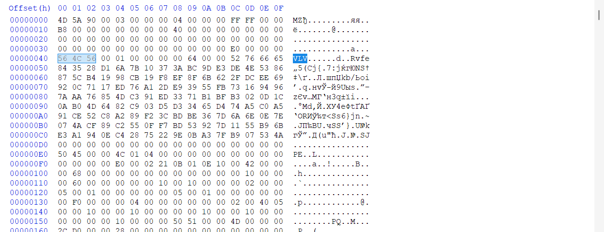
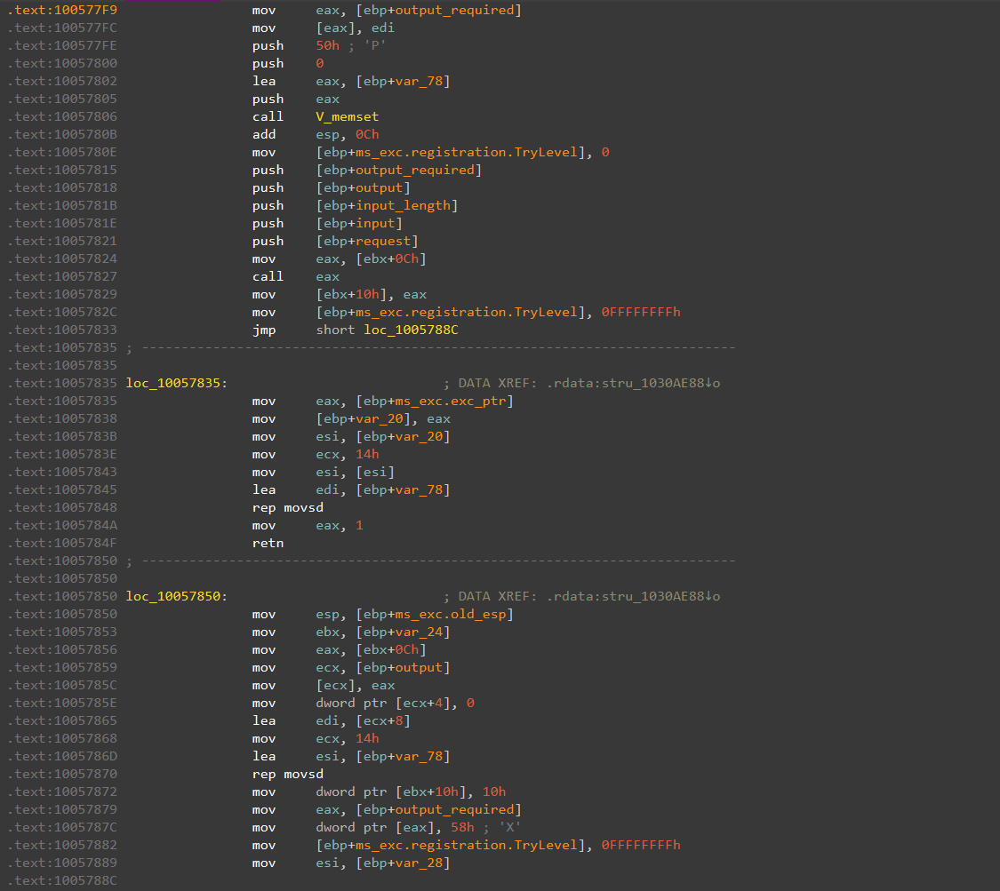
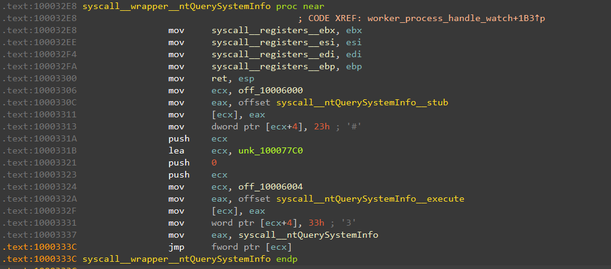
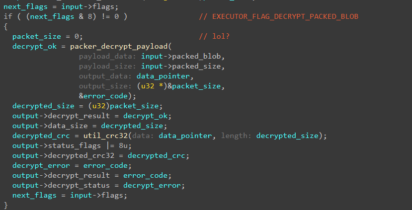
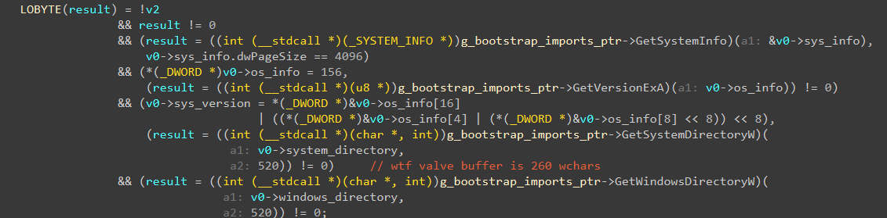
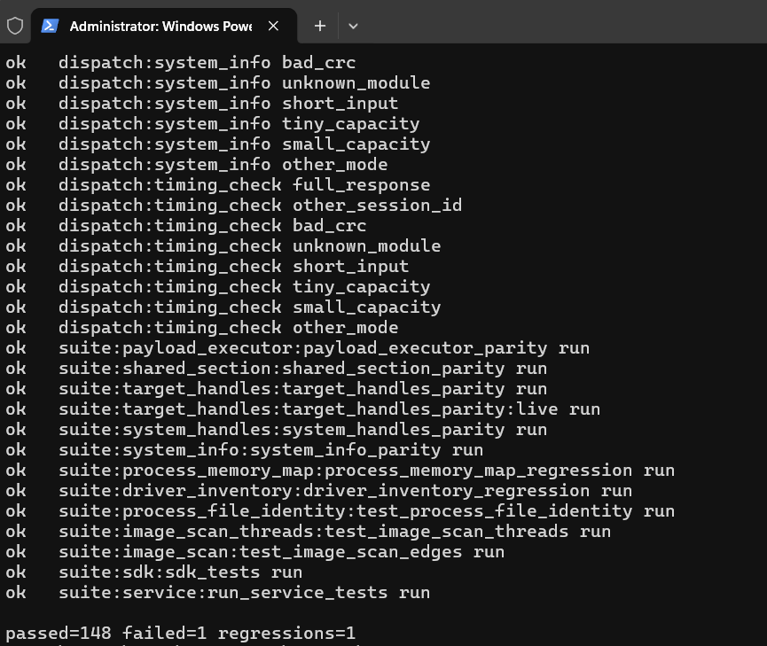

# Вскрытие мёртвого VAC: воскрешаем 15 модулей в C++20 бит в бит

Всем привет, снова врайтап, который прочтёт два с половиной человека. С переходом клиента Steam на x64 Valve практически похоронили свой классический 32-битный VAC. От былого зоопарка в живых остался разве что один одинокий HWID-модуль, который иногда прокручивается во внешнем 32-битном `steamservice`, а вся основная пачка боевых сканеров ушла в могилу. Сегодня я, страдая последствиями сломанного режима, решил заняться цифровым некрофилизмом, откопать этот труп и переписать его с нуля на C++20. Причём так, чтобы каждый модуль на тех же входах выдавал ровно те же 4232 байта отчёта, что и оригинальная DLL от Valve. Бит в бит, со всеми их багами и мусором со стека.

На руках у нас 15 модулей-сканеров и сам хост `steamservice.dll` (CRC `7ebac2a4`). Погнали смотреть, как эта штука жила и почему в итоге сдохла.


---

## Часть 1: Кто дёргает за ниточки (`steamservice.dll`)

Сами по себе модули VAC это тупые DLL без сохранения состояния. Прилетел пакет от сервера, отработал сканер, выплюнул 4 килобайта отчёта и забыл. Поэтому раскопки логичнее начинать с хоста `steamservice.dll`, который эти модули принимает, проверяет и крутит в памяти.

Внутри `steamservice.dll` разработчики Valve по старой традиции забыли строки ассертов с путями к исходникам, а старые билды под macOS вообще сохранили часть символов. Так что гадать не пришлось. Менеджер модулей жил в `SteamServiceClient/servicemodulemanagerbase.cpp` и `servicemodulemanagerasync.cpp`, а за процессами приглядывал `common/vacprocessmonitor.cpp`.

Весь путь запроса внутри сервиса укладывается в несколько шагов:

1. Клиент Steam шлёт IPC-запрос в `CServiceEngine::RunInterface` (интерфейс с ID `2`), откуда вызов падает в очередь `CClientModuleManagerAsync::CallFunctionAsync` с одним рабочим потоком.
2. Поток забирает задачу в `CWorkItemFunctionCall::ThreadProcess` и, если не выставлен флаг `MF_LEGACY_COMPATIBLE` (`8`), передаёт её в `CallFunctionAsyncInternal`.
3. `LoadDynamicModule` сверяет `CRC32` образа и проверяет криптографическую подпись модуля через `VerifyValveSignature`.
4. Если передан флаг `MF_HIDDEN_MODULE` (`2`), модуль мапится в память вручную через `LoadModuleHiddenInternal`. Иначе DLL просто сбрасывается во временный файл на диск и грузится обычным `LoadLibrary`.
5. Сервис находит экспорт `_runfunc@20`, вызывает его под SEH (`__try / __except`) и возвращает либо 4232 байта зашифрованного отчёта, либо 88 байт краш-репорта `ExceptionResponse_t` со статусом `16` (`k_ECallResultException`).

### Подпись поверх DOS-стаба

Первым делом `LoadDynamicModule` проверяет `CRC32` прилетевшей DLL и зовёт `VerifyValveSignature`. Обычные люди кладут цифровую подпись в стандартную PE-директорию `IMAGE_DIRECTORY_ENTRY_SECURITY`. Но в Valve решили не заморачиваться с парсингом сертификатов Windows и тупо впилили свой 144-байтный заголовок поверх стандартного DOS-стаба ("This program cannot be run in DOS mode"), прямо за `IMAGE_DOS_HEADER` по смещению `0x40`:

```cpp
// service/src/signature/valvesignature.cpp
// @note / sapdragon: the signature block sits in the dos stub, right after the dos header
struct ValveSignatureHeader_t
{
	uint32_t m_unMagic;           // +0x40: 'VLV' (0x564C56)
	uint32_t m_unVersion;         // +0x44: 1
	uint32_t m_cubSigned;         // +0x48: размер подписанного образа
	uint32_t m_unReserved;        // +0x4C: 0x65667652 ('Rvfe', проверкой игнорируется)
	uint8_t m_rgubSignature[128]; // +0x50..+0xCF: подпись RSA-1024
};
static_assert( sizeof( ValveSignatureHeader_t ) == 0x90 );
```

Проверка простая как три копейки. Сервис зануляет в памяти эти 128 байт подписи, поле `CheckSum` и директорию безопасности, считает `SHA-1` по файлу и сверяет PKCS#1 подпись зашитым публичным ключом RSA-1024 (`e = 17`). Таблица ключей в сервисе рассчитана на два слота, но первый слот пустой, поэтому реальный ключ всего один, и все наши 15 модулей подписаны именно им.



### Дефолтный Manual Map и краш-репорты

Дальше DLL нужно загрузить. Если флаг `MF_HIDDEN_MODULE` (`2`) не передан, сервис тупо сбрасывает файл во временную папку и зовёт `LoadLibrary`. А если флаг стоит, включается `LoadModuleHiddenInternal`:

```cpp
// service/src/image_loader/win32imageloader.hpp
struct CWin32ModuleLoader
{
	BOOL m_bModuleLoaded;
	void *m_pBaseAddress;
	PIMAGE_NT_HEADERS32 m_pNTHeaders;
	uint32_t m_uiImportedModulesCount;
	HMODULE *m_ppImportedModules;
};
static_assert( sizeof( CWin32ModuleLoader ) == 0x14, "the original allocates exactly this much" );
```

Никакой магии тут нет, это самый базовый manual map из любого учебника. Выделили буфер под `SizeOfImage`, раскидали секции, поправили релокации, зарезолвили импорты, выставили права страниц и руками нашли экспорт `_runfunc@20`, чтобы модуль лишний раз не светился в `PEB->Ldr`. У всех модулей в заголовке прописан `AddressOfEntryPoint = 0`, так что `DllMain` даже не дёргается. После запуска модуль остаётся висеть в кэше менеджера и выгружается только через полчаса (`1800` секунд) полного простоя.

Куда интереснее то, что происходит при падении модуля. Вызов `_runfunc@20` обёрнут в SEH `__try / __except`. Если сканер внутри криво полез в память и словил Access Violation, сервис не падает, а пихает прямо в выходной буфер структуру `ExceptionResponse_t` на `0x58` (88) байт:

```cpp
// service/src/module_manager/servicemodulemanagerbase.hpp
struct ExceptionResponse_t
{
	PfnServiceFunction_t m_pServiceFunction; // +0x00: адрес _runfunc@20
	uint32_t m_unReserved;                   // +0x04: 0
	EXCEPTION_RECORD32 m_Record;             // +0x08: 80 байт EXCEPTION_RECORD
};
static_assert( sizeof( ExceptionResponse_t ) == 0x58 );
```

Поэтому буфер ответа в сервисе не может быть меньше 88 байт. Статус вызова меняется на `16` (`k_ECallResultException`), и тут же в `PollResponseAsync` вылезает первый привет от кодеров Valve. Если выходной буфер вызывающего слишком мал для обычного ответа, функция честно возвращает `OutputTooSmall` (`5`), а вот если туда не поместился 88-байтный краш-репорт, она почему-то возвращает `OutputTooLarge` (`15`). Ну, перепутали константы, с кем не бывает.



Ещё там есть странная ветка под флагом `8` (`MF_LEGACY_COMPATIBLE`). В этом режиме сервис вообще не проверяет подпись и не грузит модуль в себя, а сохраняет на диск `legacycompat/servicecall_<crc>.dll` и `.in`, запускает внешний `legacycompat/steamservice.exe /runfunc ...`, ждёт 20 секунд и забирает `.out`.

---

## Часть 2: Вскрываем сам модуль и собираем SDK

Теперь заглянем внутрь типичной DLL модуля. Когда открываешь первый попавшийся бинарник в IDA, сначала кажется, что там куча кода. Но стоит открыть второй и третий, как понимаешь, что 70% функций в них написаны под копирку. У всех модулей нет стандартного CRT, почти пустой статический импорт из `kernel32.dll` и один экспорт `_runfunc@20`.

Всю эту общую часть я вынес в `sdk/src`:

- `core/` содержит точку входа `_runfunc@20`, секцию `.vacini`, диспетчер `RunDispatcher`, песочницу страниц для буфера отчёта и упаковщик ответа `SealResponse`.
- `bootstrap/` отвечает за `BootstrapMain`, расшифровку массива импортов `g_EncryptedBlob` (`0xFC0` байт), резолв 172 функций в таблицу `s_Imports` и сбор `ModuleSession_t`.
- `crypto/` включает 16-раундовый блочный шифр ICE, самописный `Bignum_t`, RSA-512 без паддинга, PRNG Парка-Миллера, `CRC32`, `MD5` и полиномиальный хеш `Hash488781ED`.
- `nt/`, `pe/`, `process/`, `file/`, `compress/`, `verify/` дают хелперы под чтение `PEB32`/`PEB64`, потоковый расчёт нормализованного MD5 PE-образов со снятием релокаций, открытие файлов по NTFS File ID, встроенный `LZ4` и проверку сертификатов WinTrust.

И вот уже на базовом маршруте от `_runfunc@20` до воркера начинаются фирменные приколы Valve.

### 1. Костыль вместо CRT (`.vacini`) и инициализация дважды подряд

Раз CRT вырезан, а `DllMain` не вызывается, кто-то должен зарегистрировать функции сканеров при старте. Для этого в секцию `.vacini` складываются указатели на функции инициализации, которые вешают структуру воркера `Module_t` в глобальный односвязный список `g_pModuleListHead`:

```cpp
// sdk/src/core/module.hpp
struct Module_t
{
	Module_t *m_pNext;       // +0x00
	u32 m_unId;              // +0x04: ID воркера
	u32 m_unVersion;         // +0x08: версия (везде 1)
	PfnWorker_t m_pfnWorker; // +0x0C: указатель на функцию сканера
	u8 m_rgubIceKey[36];     // +0x10: ключ ICE (реально берутся только первые 8 байт)
};
VAC_LAYOUT_SIZE( Module_t, 0x34 );
```

На входе в `_runfunc@20` вызывается `CallInitializers()`, которая пробегает по `.vacini`. Дальше код смотрит на `nMode`, и если передали не `4`, сразу возвращает `3` (`NoDispatch`). А вот после того, как диспетчер отработал, идёт прекрасное:

```cpp
// sdk/src/core/entry.cpp
// @note / sapdragon: non-zero from the start, so the initializers always run again after dispatch
constinit u32 s_bRunInitializersAgain = 0xFFFFFFFFu;
// ...
	if ( s_bRunInitializersAgain )
		CallInitializers();
```

Кто-то завёл флаг `s_bRunInitializersAgain`, поставил ему дефолтное значение `0xFFFFFFFF` и забыл написать код, который его сбрасывает. В результате при каждом вызове `_runfunc@20` все инициализаторы прогоняются до скана, а потом совершенно бессмысленно прогоняются ещё раз перед самым выходом.

### 2. Пакеты, ICE и бутерброд из `PAGE_NOACCESS`

Раскладка пакетов на входе и выходе всегда фиксированная:

```cpp
// sdk/src/core/packets.hpp
struct VacInputPacket_t
{
	u32 m_unModuleId;                                // +0x00: ID воркера
	u32 m_unVersion;                                 // +0x04: версия (1)
	u32 m_unConfigCrc32;                             // +0x08: CRC32 расшифрованного конфига
	u32 m_unSessionId;                               // +0x0C: эхо-токен сессии
	u8 m_rgubEncryptedConfig[k_cubEncryptedConfig];  // +0x10..+0xAF: 160 байт под 64-битным ICE
};
VAC_LAYOUT_SIZE( VacInputPacket_t, 0xB0 );

struct VacReportHeader_t
{
	u32 m_unSessionId;                               // +0x00: перезаписывается диспетчером после воркера
	u32 m_unWorkerResult;                            // +0x04: код возврата m_pfnWorker
	u32 m_unReserved;                                // +0x08: 0
};
VAC_LAYOUT_SIZE( VacReportHeader_t, 0x0C );

struct VacOutputPacket_t
{
	u8 m_rgubEncryptedReport[k_cubReport];           // +0x0000..+0x0FFF: 4096 байт отчёта под сессионным ICE
	u32 m_cubRsaPayload;                             // +0x1000: 0x40
	u32 m_unRsaStatus;                               // +0x1004: 0 при успехе RSA
	u8 m_rgubRsaSessionKey[0x80];                    // +0x1008..+0x1087: SessionKey_t под RSA-512
};
VAC_LAYOUT_SIZE( VacOutputPacket_t, 0x1088 );
```

`RunDispatcher` ищет нужный `Module_t` по ID (причём условие в цикле написано так, что если попадётся пустой узел с `m_pfnWorker == nullptr`, поиск радостно остановится на нём и попытается вызвать нулевой указатель), расшифровывает 160 байт параметров алгоритмом ICE (любимый блочный шифр Valve ещё со времён Source) и проверяет `CRC32`.

А дальше видно, насколько в Valve "доверяли" коду своих же сканеров. Вместо того чтобы выделить под 4096-байтный отчёт обычный буфер в куче, диспетчер выделяет через `VirtualAlloc` регион с правами `PAGE_NOACCESS`, и только внутренним страницам выдаёт `PAGE_READWRITE`, оставляя по одной мёртвой странице с каждого края:

```cpp
// sdk/src/core/dispatcher.cpp
	const u32 cubSandbox = s_cubPage * ( ( s_cubPage + sizeof( VacOutputPacket_t ) - 1 ) / s_cubPage + 2 );
	u8 *pubSandbox = static_cast<u8 *>( VirtualAlloc( nullptr, cubSandbox, MEM_COMMIT | MEM_RESERVE,
	                                                  util::MapProtectionFlags( util::EProtectMode::NoAccess ) ) );
// ...
	u8 *pubReport = pubSandbox + s_cubPage;
	if ( VirtualProtect( pubReport, cubSandbox - 2 * s_cubPage,
	                     util::MapProtectionFlags( util::EProtectMode::ReadWrite ), &unOldProtect ) )
```

То есть если воркер при записи отчёта промахнулся с индексом и вылез за две рабочие страницы (8 КБ под `VacOutputPacket_t`), он не портит кучу сервиса, а моментально бьётся лбом об `PAGE_NOACCESS` и улетает в SEH-обработчик с краш-репортом.


### 3. Одинаковый блоб на 172 импорта во всех модулях (`BootstrapMain`)

Чтобы по заголовку PE нельзя было понять, какие WinAPI дёргает сканер, статическая таблица импортов у модулей почти пустая. Настоящий список импортов зашит в `.rdata` в массиве `g_EncryptedBlob` на `0xFC0` (4032) байта. Когда воркер стартует, он зовёт `BootstrapMain(&input)`, и тот расшифровывает этот блоб через ICE, беря первые 8 байт открытого входного конфига как ключ.

Казалось бы, хитро: без перехваченного сетевого пакета с параметрами ты даже строки импортов статически не прочитаешь. Вот только когда я расшифровал эти блобы во всех модулях, выяснилось, что Valve вообще не меняли их содержимое! Во всех модулях лежит байт в байт один и тот же список из 172 функций из 12 системных DLL (`kernel32`, `ntdll`, `advapi32`, `setupapi`, `wintrust` и т.д.). Поэтому в SDK этот блоб просто собирается в compile-time через `consteval BuildBlobImage()`:

```cpp
// sdk/src/bootstrap/blob.hpp
inline constexpr ImportName_t k_rgImportNames[] = {
#define VAC_IMPORT( szLibrary, ReturnType, Name, Args ) { szLibrary, #Name },
#include "bootstrap/imports.inl"
#undef VAC_IMPORT
};
static_assert( ARRAYSIZE( k_rgImportNames ) == 172 );
```

Даже если модулю `cpuid` нужна ровно одна функция `SetThreadAffinityMask`, `BootstrapMain` всё равно при каждом запуске грузит все 12 библиотек и резолвит все 172 указателя в `s_Imports`.

### 4. Запечатывание ответа (`SealResponse`) и RSA без паддинга

Когда воркер отработал, `SealResponse` пакует результат для отправки на сервер:

1. Заводится простенький PRNG Парка-Миллера (`ParkMiller_t`) с сидом от `__rdtsc()`.
2. Генерируется случайный 8-байтный ключ ICE и структура `SessionKey_t`, куда также пишется реальный размер собранных данных `*pcubOutput`.
3. Весь незаполненный хвост 4096-байтного отчёта до конца забивается мусором из PRNG, чтобы размер пакета всегда был одинаковым.
4. 28 байт структуры `SessionKey_t` шифруются публичным ключом RSA-512 (`k_rgubRsaPublicKey`), а сам 4096-байтный отчёт закрывается сессионным ключом ICE. Причём RSA тут буквально из школьного учебника: никакого PKCS#1 или OAEP паддинга нет, самописный `Bignum_t` просто возводит число в степень $m^e \bmod n$ в лоб. На выходе всегда получается пакет ровно на `0x1088` (4232) байта.

---

## Часть 3: Карта всех 15 модулей

Прежде чем копаться в самых угарных воркерах, посмотрим на всю выкопанную коллекцию. У некоторых модулей попадались парные пересборки с другими ключами, а `image_scan` и `image_scan_threads` вообще скомпилированы из одного кода (секция `.text` совпадает побайтово, кроме таймстампов), просто в одном дёргается первый воркер, а в другом второй.

| Модуль | CRC сборок | ID воркеров | Что делает |
|---|---|---|---|
| `boot_config` | `2909d63a` | `0x06A79A9E` | Читает куст реестра `HKLM\BCD00000000\Objects`: пути загрузчика, ядра и HAL, флаги `testsigning`, `nointegritychecks`, политику NX, плюс NTFS File ID и серийник тома. |
| `cpuid` | `f418b1dc` | `0x023429C3` | Пинит поток к CPU 0 и дампит листья `CPUID` от `0x0`, `0x40000000` (гипервизор проверяется раньше расширенных листьев) и `0x80000000`, до 169 записей. |
| `devices` | `40e4df95` | `0x05EC50DC` | Выгребает активные PCI и USB устройства через SetupAPI, до 508 троек `VendorID / DeviceID / Class`. |
| `driver_inventory` | `2023d8c3` | `0x06ACD913`<br/>`0x06C2B5BB` | Два воркера: первый сверяет активные драйверные сервисы (`EnumServicesStatusW`) с ядерной папкой `\Driver`; второй считает нормализованный MD5 файлов драйверов на диске (до 203 штук). |
| `image_scan` | `33211402` | `0x0CDA6778`<br/>`0x09D3248C` | Два воркера: скан PE на диске и в памяти (заголовки, MD5 секций со снятыми релокациями, иконки, PDB, сертификаты WinTrust, потоковый паттерн-скан) + дамп до 253 потоков процесса с их стартовыми адресами. |
| `image_scan_threads` | `74aa703a` | `0x05A52008`<br/>`0x0122C7DA` | Тот же самый `.text`, что и в `image_scan`, только с другими ключами и ID воркеров. |
| `payload_executor` | `60e41c53` | `0x0236ED5F` | Аллокация памяти, RSA-распаковка блоба, выставление `PAGE_EXECUTE_READWRITE` и вызов функции по смещению. |
| `process_file_identity` | `a8848995`<br/>`42878040` | `0x0B2D8276`<br/>`0x0CA11165`<br/>`0x013B4330`<br/>*(и `0x0E5CD15B`, `0x05CEDF74`, `0x0FF6FF81`)* | Три воркера: досье на процесс (SID, PEB32/64, cmdline, хеши), цепочка NTFS File ID всех папок-предков и опись до 200 файлов в каталоге. |
| `process_memory_map` | `8d88e017`<br/>`78a6ef0f` | `0x06E048F4`<br/>`0x0DB55D3C` | Обходит `PEB->Ldr` и регионы памяти процесса, схлопывает страницы, считает нормализованный MD5 до 32 PE-образов и жмёт хвост отчёта через LZ4. |
| `service_lookup` | `87f12249` | `0x0FA94991` | Ищет конкретный драйвер по хешу имени сервиса, разворачивает `sysnative`, забирает конфиг службы и NTFS File ID файла. |
| `shared_section` | `2794a04`<br/>`9b85c913` | `0x0E3481C0`<br/>`0x06781BC4` | Ищет секцию памяти по шаблону GUID через `OpenFileMappingW` и обход дерева объектов NT `\`, читая 4072 байта со смещения 24. |
| `system_handles` | `1da8fb5c`<br/>`9f73e639` | `0x002F6DC7`<br/>`0x0929BC41` | Снапшот процессов, 64-битные маски типов хендлов на каждый PID и брутфорс скрытых процессов вниз с шагом 4 через `OpenProcess`. |
| `system_info` | `a07ed54b` | `0x0F8083A0`<br/>`0x0C2232C2` | Два узла на один воркер: сводка об ОС, таймеры `KUSER_SHARED_DATA`, тома и парсинг `ntdll.dll` с диска ради 4 сырых номеров сисколлов (SSN). |
| `target_handles` | `762110ce` | `0x08A9324E` | Прыгает из 32-битного WoW64 в x64 через Heaven's Gate (`0x33`) и прямыми сисколлами ищет чужие процессы с открытым хендлом на игру. |
| `timing_check` | `de9615cb` | `0x0D8C40E1` | Старый модуль без `BootstrapMain`: замеряет тики `KUSER_SHARED_DATA` вокруг вызова самомодифицирующегося стаба в `.data`. |

Рутину вроде опроса USB-девайсов или чтения ключей BCD оставим за кадром, а вот на самых интересных механиках остановимся подробнее.

---

## Часть 4: Пять интересных механик внутри сканеров

### 1. Дуэт `system_info` и `target_handles`: прыжок через Heaven's Gate (`0x33`)

Когда я открыл `target_handles` (`762110ce`), задача модуля была очевидна: найти любой процесс в системе, который держит открытый хендл на процесс игры. Но античит крутится внутри 32-битного процесса под WoW64. Если просто позвать `NtQuerySystemInformation` из 32-битной `ntdll.dll`, во-первых, тебя легко перехватят обычным сплайсингом, а во-вторых, 32-битная структура `SYSTEM_HANDLE_TABLE_ENTRY_INFO` обрежет 64-битные адреса ядерных объектов.

И тут пазл сложился с другим модулем, `system_info` (`a07ed54b`). Смотрите за руками: сначала `system_info` читает с диска чистый файл `ntdll.dll`, парсит экспорты и выдирает из прологов четырёх функций (`NtReadVirtualMemory`, `NtQueryVirtualMemory`, `NtOpenProcess`, `NtQuerySystemInformation`) сырые номера системных вызовов (SSN). Сервер забирает этот отчёт, а потом присылает в `target_handles` входной пакет, где по смещениям `+0x68` и `+0x6C` уже лежат готовые SSN под конкретный билд Windows игрока!

Дальше `target_handles` делает дальний переход `jmp fword` на селектор `0x33` (Heaven's Gate, привет Slyaqot!), переключая процессор из 32-битного режима в 64-битный, и лупит прямым 64-битным `syscall`. Поскольку 32-битный ассемблер MSVC не умеет в 64-битные инструкции и `REX`-префиксы, в рекоде пришлось выкладывать шлюз сырыми байтами через `__asm _emit`, прямо как в оригинале:

```cpp
// modules/target_handles/internal/syscalls.cpp
__asm _emit 0x48 __asm _emit 0x8B __asm _emit 0x4C __asm _emit 0x24 __asm _emit 0x08 /* mov rcx, [rsp+8] */   \
__asm _emit 0x48 __asm _emit 0x8B __asm _emit 0x54 __asm _emit 0x24 __asm _emit 0x10 /* mov rdx, [rsp+10h] */ \
__asm _emit 0x4C __asm _emit 0x8B __asm _emit 0x44 __asm _emit 0x24 __asm _emit 0x18 /* mov r8, [rsp+18h] */  \
__asm _emit 0x4C __asm _emit 0x8B __asm _emit 0x4C __asm _emit 0x24 __asm _emit 0x20 /* mov r9, [rsp+20h] */  \
__asm _emit 0x4C __asm _emit 0x8B __asm _emit 0xD1                                   /* mov r10, rcx */       \
__asm _emit 0x0F __asm _emit 0x05                                                    /* syscall */            \
__asm _emit 0x4C __asm _emit 0x8B __asm _emit 0x17                                   /* mov r10, [rdi] */     \
__asm _emit 0x48 __asm _emit 0x33 __asm _emit 0xC9                                   /* xor rcx, rcx */       \
__asm _emit 0x8B __asm _emit 0x0C __asm _emit 0x24                                   /* mov ecx, [rsp] */     \
__asm _emit 0xFF __asm _emit 0x29                                                    /* jmp far [rcx] */
```



Через этот шлюз модуль сам открывает процесс игры, забирает 64-битную `SystemHandleInformation`, находит там свой собственный хендл, чтобы узнать 64-битный адрес ядерного объекта `m_ulObject`, а затем в цикле из 10 проходов ловит всех, у кого в таблице мелькнул тот же самый ядерный адрес.

### 2. Брутфорс скрытых PID с шагом 4 в `system_handles`

В `system_handles` (`1da8fb5c`) проверяется старый как мир трюк с прятками процесса из пользовательских списков:

1. Сначала модуль делает обычный Toolhelp-снапшот и собирает до 500 видимых PID.
2. Затем запрашивает системную таблицу `SystemHandleInformation`, строит 64-битную маску типов хендлов на каждый процесс и докидывает в список все PID, которые засветились в таблице хендлов, но отсутствовали в снапшоте.
3. А в финале запускается `ScanPidRange`. Поскольку PID в Windows всегда кратны четырём, функция берёт максимальный найденный PID и тупо шагает вниз до нуля с шагом `unPid -= 4`, дёргая `OpenProcess(PROCESS_QUERY_LIMITED_INFORMATION)` на каждый четвёртый номер.

Если процесса реально нет, ядро вернёт `ERROR_INVALID_PARAMETER`. А вот если кто-то вырезал свой процесс из `EnumProcesses` или снапшота, но ядро на `OpenProcess` ответило успехом или хотя бы `ERROR_ACCESS_DENIED`, процесс тут же палится и улетает в отчёт с флагом `NotInSnapshot`.

### 3. Откат релокаций на лету и LZ4 в `process_memory_map`

Если ты хочешь сравнить загруженную в память DLL с оригинальным файлом на диске по хешу, просто посчитать MD5 секции `.text` в памяти нельзя, потому что загрузчик Windows уже пропатчил код релокациями под текущий базовый адрес (ASLR).

Поэтому в `process_memory_map`, `driver_inventory` и `image_scan` живёт потоковый ридер `CPeReader` с 8-килобайтным скользящим окном. Он читает образ кусками по 4 КБ, находит таблицу `.reloc` и прямо внутри окна вычитает дельту загрузки назад к дефолтному `ImageBase` (причём если 4-байтная релокация попала на стык двух 4-килобайтных блоков, её хвост честно патчится во второй половине окна и попадает в MD5 следующей итерации). Таблицы импорта и экспорта при этом вырезаются. В итоге чистая DLL в памяти даёт байт в байт тот же MD5, что и на диске. А чтобы впихнуть всю карту памяти процесса в 4096 байт отчёта, `process_memory_map` в конце сжимает собранные данные встроенным LZ4.

### 4. Патч `.data` и суицид через `MEMORY[4] = 4` в `timing_check`

Модуль `timing_check` (`de9615cb`) вообще выглядит как ископаемое: там нет `BootstrapMain`, а весь его отчёт весит 32 байта. В секции `.data` лежит 6-байтный стаб `B8 99 99 99 99 C3` (`mov eax, 0x99999999; ret`). Воркер читает тики из `KUSER_SHARED_DATA` (`0x7FFE0000`), проверяет `PEB->BeingDebugged`, перезаписывает константу в стабе числом из входного пакета, вызывает `.data` как функцию и ксорит результат со вторым замером тиков (причём у самой секции `.data` в оригинале стоят обычные флаги `0xC0000040` без прав на исполнение, так что при включённом DEP она вообще должна складываться в SEH):

```cpp
// modules/timing_check/entry.cpp
	report.m_unMagic = k_unReportMagic;

	report.m_unTimingCheck ^= SampleTickCount();
	report.m_unBeingDebugged = NtCurrentTeb()->ProcessEnvironmentBlock->BeingDebugged;

	s_Stub.m_unImmediate = input.m_unStubValue;
	report.m_unTimingCheck ^= reinterpret_cast<PfnStub_t>( &s_Stub )();
	report.m_unTimingCheck ^= SampleTickCount();
	return 0;
```

Но самое смешное тут в диспетчере. Этот модуль собирали ещё до того, как в SDK прикрутили песочницу на `VirtualAlloc`. Буфер отчёта тут выделяется прямо на стеке между канарейками `0xAAAAAAAA` и `0x55555555`. И если канарейку задели, диспетчер не возвращает код ошибки, а делает вот так:

```c
// Вывод Hex-Rays: analysis/export/de9615cb/decompiled.c (sub_10003923)
        *a4 = 4232;
        if ( v27 != -1431655766 || v28 != -1431655766 || v29[1024] != 1431655765 || v29[1025] != 1431655765 )
          MEMORY[4] = 4;
        return 1;
```

Тупо запись четвёрки по адресу `0x00000004`, чтобы гарантированно уронить поток в SEH-обработчик `steamservice.dll` и отправить на сервер `EXCEPTION_RECORD`!

### 5. Пятиминутный откат времени в ETW-мониторе (`steamservice.dll`)

В самом сервисе рядом с загрузчиком модулей крутится `CClientProcessMonitor`, который поднимает ETW-сессию `Steam Event Tracing` на ядерном провайдере `Microsoft-Windows-Kernel-Process`.

Зачем он нужен, если игра ещё даже не запущена? А затем, что сервис держит кольцевой буфер всех запусков и завершений процессов в системе за последние 5 минут (`3000000000` стонаносекундных тиков). Когда ты запускаешь игру и вызывается `RegisterProcess(unPid)`, сервис отматывает плёнку на 5 минут назад и скармливает всю накопленную историю в контекст нового процесса. То есть схема "запустил инжектор, закрыл инжектор, запустил игру через минуту" палится этим буфером на раз-два.

---

## Часть 5: Что не так с `payload_executor` (`60e41c53`)

Отдельно от остальных 14 модулей стоит `60e41c53` (ID `0x0236ED5F`, имя `payload_executor` я дал ему сам). В нём вообще нет никаких проверок системы. Вместо этого внутри сидит коротенький диспетчер команд на 50 строк, который смотрит на битовые флаги `m_eFlags` из входного пакета, а в самом PE-файле лежит 16-килобайтная высокоэнтропийная секция `.etext` (`CRC32 = 0xF9B311BC`):

```cpp
// modules/payload_executor/entry.cpp
	u8 *pubData = nullptr;
	if ( HasFlag( input.m_eFlags, EPayloadFlags::Allocate ) ) // 0x02
	{
		pubData =
		    static_cast<u8 *>( pImports->VirtualAlloc( nullptr, input.m_cubAllocation, MEM_COMMIT, PAGE_READWRITE ) );
		report.m_unAllocatedMemory = static_cast<u32>( reinterpret_cast<uptr>( pubData ) );
		report.m_eFlags |= EPayloadFlags::Allocate;
		report.m_cubData = input.m_cubAllocation;
	}
	if ( HasFlag( input.m_eFlags, EPayloadFlags::ExistingPointer ) ) // 0x04
	{
		pubData = reinterpret_cast<u8 *>( static_cast<uptr>( input.m_unDataPointer ) );
		report.m_eFlags |= EPayloadFlags::ExistingPointer;
	}
	report.m_unBaseCrc32 = crypto::hash::Crc32_t::Of( k_rgubBase, sizeof( k_rgubBase ) );
	if ( HasFlag( input.m_eFlags, EPayloadFlags::Decrypt ) ) // 0x08
	{
		// @note / sapdragon: capacity really is 0, so any non empty result ends in error 3 and the crc still runs
		// over the required size. the error code then overwrites the bool
		u32 cubPlain = 0, unError = 0;
		report.m_unDecryptResult =
		    DecryptPayload( input.m_rgubPackedBlob, input.m_cubPacked, pubData, &cubPlain, &unError );
		report.m_cubData = cubPlain;
		report.m_unDecryptedCrc32 = crypto::hash::Crc32_t::Of( pubData, cubPlain );
		report.m_eFlags |= EPayloadFlags::Decrypt;
		report.m_unDecryptResult = report.m_unDecryptStatus = unError;
	}
	if ( HasFlag( input.m_eFlags, EPayloadFlags::MakeExecutable ) ) // 0x10
	{
		DWORD unOldProtect = 0;
		pImports->VirtualProtect( pubData, input.m_cubAllocation, PAGE_EXECUTE_READWRITE, &unOldProtect );
		report.m_eFlags |= EPayloadFlags::MakeExecutable;
	}
	if ( HasFlag( input.m_eFlags, EPayloadFlags::Call ) ) // 0x20
	{
		using Entry_t = void( __cdecl * )( ModuleSession_t *, u32 *, Report_t * );
		reinterpret_cast<Entry_t>( pubData + input.m_ibEntry )( g_pSession, &input.m_unDataPointer, &report );
		report.m_eFlags |= EPayloadFlags::Call;
	}
	if ( HasFlag( input.m_eFlags, EPayloadFlags::Free ) ) // 0x40
	{
		// @note / sapdragon: valve really passes MEM_FREE here, not MEM_RELEASE. don't fix it
		::VirtualFree( pubData, input.m_cubAllocation, MEM_FREE );
		report.m_eFlags |= EPayloadFlags::Free;
	}
```

С виду это готовый модуль для запуска произвольного шеллкода с сервера, которому при вызове `Call` (`0x20`) заботливо передают контекст `ModuleSession_t` (с путями, PID, версией ОС и хендлом `ntdll`). Но когда смотришь на этот код вблизи, начинается чистая комедия:

1. В перехваченном реальном пакете `m_eFlags == 0`. То есть модуль прилетал на клиент, тупо считал `CRC32` своей секции `.etext`, клал его в отчёт и выгружался.
2. Ветка расшифровки `Decrypt` (`0x08`) сломана так, что не может сработать в принципе. Кодер Valve завёл переменную `cubPlain = 0` и передал её в `DecryptPayload` как ёмкость выходного буфера! Распаковщик смотрит на ноль, говорит "места нет, нужно столько-то байт", возвращает ошибку `3` и ничего не пишет в `pubData`. А код снаружи как ни в чём не бывало считает `CRC32` по пустому `pubData` на длину `cubPlain` и затирает результат кодом ошибки.
3. Мало того, в ветке `Free` (`0x40`) при вызове `VirtualFree` вместо флага `MEM_RELEASE` (`0x8000`) на стек пушится `0x10000` (`MEM_FREE`), из-за чего память даже освободиться не может.



Короче, кто-то в Valve набросал загрузчик пейлоадов, даже не запустил ветки распаковки и очистки в отладчике, подписал релизным ключом и выкатил в прод в режиме "посчитай CRC32 и выйди". И таких перлов в коде античита оказалось вагон.

---

## Часть 6: Баги Valve (`// valve bug, keep it`) и пасхалки

Когда переписываешь код ради побайтового совпадения отчётов, чужие баги чинить нельзя, иначе отчёт разъедется с оригиналом. Так в коде появился комментарий `// valve bug, keep it`. Коротко про самые смешные косяки в коде Valve:

### 1. Сид хеша от адреса переменной и 520 байт в `wchar_t[260]` (`BootstrapMain`)

В `GetSystemDirectoryW` вместо длины в символах (`260`) передали размер в байтах (`520`), а строчкой ниже в `UpdateIntegrityHash` поставили лишний `&`, засеяв хеш таблицы импортов адресом самой переменной `g_unIntegrityHash`, а не её значением:

```cpp
// sdk/src/bootstrap/bootstrap.cpp
	return g_pImports->GetSystemDirectoryW( pSession->m_wszSystemDirectory, 520 ) &&
	       g_pImports->GetWindowsDirectoryW( pSession->m_wszWindowsDirectory, 520 );
}

void UpdateIntegrityHash() noexcept
{
	// @note / sapdragon: seed is the address of the hash, not its value. valve bug, keep it
	const u32 unSeed = static_cast<u32>( reinterpret_cast<uptr>( &g_unIntegrityHash ) );
	g_unIntegrityHash =
	    crypto::hash::Hash488781ED_t::Of( reinterpret_cast<const u8 *>( &s_Imports ), sizeof( s_Imports ), unSeed );
}
```



### 2. Сравнение `NTSTATUS` с Win32-ошибкой (`target_handles`)

После сырого сисколла `NtOpenProcess` код проверяет отказ в доступе, чтобы откатиться с `0x1000` на `0x400`. Только сисколл возвращает `NTSTATUS` (`0xC0000022`), а его сравнили с Win32 `ERROR_ACCESS_DENIED` (`5`), сделав фолбэк мёртвым кодом:

```cpp
// modules/target_handles/internal/scan.cpp
		// @note / sapdragon: compares a win32 code against an ntstatus, real access denied is 0xC0000022 and never takes this fallback
		if ( eStatus != static_cast<EScanStatus>( ERROR_ACCESS_DENIED ) )
			return eStatus;
```

### 3. Остальной зоопарк одной строкой

- В `system_handles` при фейле `CreateToolhelp32Snapshot` функция возвращает `60` (код ошибки!) вместо `0`, заставляя цикл читать 60 пустых слотов. Там же при `> 500` процессах массив PID переполняется в соседний массив `m_rgunParentPids`, а чтение масок хендлов уходит по стеку выше контекста и пакует в отчёт адреса возврата со стека.
- В `steamservice.dll` метод заморозки процесса `SuspendProcess` вместо `NtSuspendProcess` тупо вызывает `DebugActiveProcess(unPid)` без цикла отладки, вешаясь на процесс системным дебаггером.
- Во втором воркере `driver_inventory` создаются три хеш-таблицы строк `rgUnusedTables[3]`, ни разу не используются и в конце аккуратно удаляются. А хендлы (`\Driver`, ключи реестра BCD, процесс `steam.exe` и его токен) текут вообще в каждом втором модуле.

### 4. Пасхалка `867-5309` и `__LINE__` в отчётах

- В `process_file_identity` поля ошибок инициализируются числом `8675309` (это телефон из припева хита 80-х *"867-5309/Jenny"* группы Tommy Tutone).
- В `shared_section` вместо кодов ошибок в `m_eFailureLine` прилетают `390`, `400`, `410`, `440`, `466`, `483`. Разработчик тупо возвращал макрос `__LINE__` своего `.cpp`-файла.


---

## Часть 7: Как проверять, что рекод не врёт ни на бит

Переписать 15 модулей на глаз дело нехитрое, но без жёстких тестов это быстро превращается в "ну, вроде функции похожи". Стоит ошибиться с выравниванием структуры или знаком типа, и на реальных данных отчёт поедет.

Поэтому я проверял каждый модуль в два этапа:

1. Живой прогон (`run_all.py` и `dispatch_parity.exe`). На живой винде между двумя вызовами неизбежно меняются тики `KUSER_SHARED_DATA` и номера открытых хендлов. Чтобы отделить этот шум от моих багов, тест сначала дважды подряд запускает оригинальную DLL от Valve против самой себя, помечает изменившиеся байты как шум ОС, а затем прогоняет ребилд и требует ноль расхождений (`real_diff_bytes = 0`) во всех остальных байтах.
2. Подмена `s_Imports` и тысячи синтетических миров. На обычной машине не проверишь переполнение за 500 процессов или реакцию на битые PE-заголовки. Поэтому я написал раннеры, которые грузят оригинальную DLL от Valve, дают ей пройти `BootstrapMain`, а дальше переписывают её глобальную таблицу `s_Imports` указателями на стабы:

   - Для `system_handles` генератор создаёт 2000 случайных синтетических слепков ОС и сверяет оригинал с ребилдом на каждом. Именно так я выловил чтение стека выше контекста после 500-го процесса и добился совпадения всех 4096 байт отчёта без единого байта шума.

   - Для `driver_inventory` оба бинарника прогнали через 1500 сфаззенных кривых PE-файлов, сверяя не только отчёт, но и полный лог вызовов Win32 API с аргументами.

   - Для `payload_executor` отдельный раннер прогоняет 190 кейсов по воркеру и RSA-распаковщику.



*(На скрине, конечно, по закону подлости прямо во время живого слепка на фоне моргнул какой-то процесс и вылез `failed=1`, но переснимать лень, поверьте на слово).*

---

## Часть 8: "VAC ничего не детектит" (на самом деле просто кидает в красный траст)

На форумах годами ныли, что VAC вообще бесполезный, ничего не видит и любой школьник с manual map обходит его в два клика. Но когда смотришь на все эти 15 модулей вместе, понимаешь, что люди просто путали "не прилетел бан" с "античит ничего не спалил".

Классический VAC собирал с компа вообще всё, до чего мог дотянуться из юзермода:

- Замапил чит руками мимо `PEB->Ldr`? Модуль `process_memory_map` обходит всю виртуальную память процесса, находит приватные исполняемые страницы (`MEM_PRIVATE` с `PAGE_EXECUTE_*`), а `image_scan_threads` выгружает стартовые адреса всех потоков, которые смотрят в никуда (вне загруженных модулей).
- Запустил внешний процесс и открыл хендл на игру? `target_handles` прыгает в x64 через Heaven's Gate и палит твой хендл прямым сисколлом в ядро, а `system_handles` брутфорсит скрытые PID с шагом 4.
- Запустил лоадер, инжектнул и закрыл его за минуту до старта игры? Пятиминутный ETW-буфер в `steamservice.dll` уже записал и путь к твоему `.exe`, и его PID, и время жизни.
- Подгрузил свой кривой драйвер или включил `testsigning`? Привет от `boot_config`, `driver_inventory` и `service_lookup`, которые сверяют реестр со списком объектов `\Driver` и вытаскивают нормализованные хеши файлов по NTFS File ID.

Если бы Valve хотели выдавать хард-бан за каждый подозрительный регион памяти или левый поток, они бы перебанили пол-стима в первый же вечер. Но во времена CS:GO они сделали хитрее и просто скормили всю эту телеметрию в Trust Factor. Ты инжектишь чит, думаешь, что красиво обошёл античит, бана нет, а на деле сервер молча сложил твои флаги из отчётов, уронил тебе траст на самое дно, и ты уехал вариться в отдельном котле с такими же рейдж-читерами.


Почему тогда почти вся эта 32-битная пачка модулей отправилась на покой после переезда клиента Steam на x64? Да, сам 32-битный `steamservice` иногда ещё поднимается по IPC и крутит там один оставшийся HWID-модуль. Но в in-proc режиме внутри 64-битного `steam.exe` 32-битный `LoadModuleHiddenInternal` и 4-байтный указатель `this` в `VacProcessMonitor::CProvider` уже не работают. А главное, ковырять 64-битные процессы игр на Source 2 из 32-битных сканеров с обрезанными указателями и костылями поверх WoW64 стало просто бессмысленно.

---

## Заключение

Сегодня мы посмотрели, как мёртвый 32-битный VAC грузил модули мимо `PEB->Ldr`, как прыгал в x64 через Heaven's Gate и как сами разработчики Valve стреляли себе в ногу в каждом втором воркере. А всё это добро теперь собрано в рабочий C++20, который сходится с оригиналами до единого бита.

В целом всем пока, подписывайтесь на щитпост-блог... Ну и продолжайте ковырять бинарники, экспериментировать и, возможно, когда-то не перепутаете `seed` с `&seed`.


- Блог: [https://t.me/somethinchannel](https://t.me/somethinchannel)
- Кривая, сырая, не вкусная реализация на гитхабе: [sapdragon/vac](https://github.com/sapdragon/vac)
